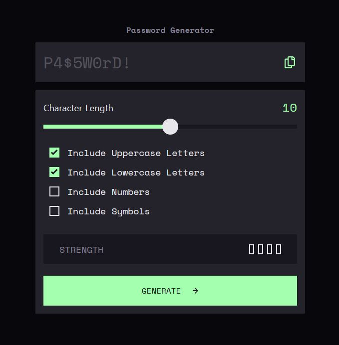

# Frontend Mentor - Password generator app solution

This is my solution to the [Password generator app challenge on Frontend Mentor](https://www.frontendmentor.io/challenges/password-generator-app-Mr8CLycqjh). The project combines reusable Every Layout patterns with a jQuery interface for generating passwords, displaying strength feedback, and copying results.

## Table of contents

- [Overview](#overview)
  - [The challenge](#the-challenge)
  - [Requirement status](#requirement-status)
  - [Screenshot](#screenshot)
  - [Links](#links)
- [My process](#my-process)
  - [Built with](#built-with)
  - [Running locally](#running-locally)
  - [What I learned](#what-i-learned)
  - [Validation](#validation)
  - [Continued development](#continued-development)
  - [Useful resources](#useful-resources)
  - [AI Collaboration](#ai-collaboration)
- [Author](#author)
- [Acknowledgments](#acknowledgments)

## Overview

### The challenge

The challenge is to build a responsive password generator with configurable character types, clipboard copying, strength feedback, and interactive control states.

The current implementation lets users:

- Choose a password length from 1 to 20 characters.
- Include uppercase letters, lowercase letters, numbers, and symbols.
- Start with lowercase letters selected, and see an inline message instead of a password when every character type is cleared or the length is too short for the selected types.
- Include at least one character from every selected type. The requested length must accommodate those types.
- See the generated password and a four-level strength indicator.
- Copy the result and see a confirmation for two seconds, with a separate screen reader status message. Copying before generating, or a clipboard failure, shows an inline message below the password.

Passwords use `crypto.getRandomValues()` for random selection. Because every character is chosen at random, the strength display estimates entropy as `length × log2(pool size)`, where the pool is the total size of the character groups used (26 uppercase, 26 lowercase, 10 numbers, 29 symbols). The thresholds are a UI rule for these generated passwords, not a guarantee against real attacks.

| Entropy | Label | Filled bars | State class on `.c-strength` | Examples |
| --- | --- | --- | --- | --- |
| Below 36 bits | TOO WEAK! | 1 | `is-too-weak` (red) | 5 lowercase letters (23.5 bits) |
| 36 bits or more | WEAK | 2 | `is-weak` (orange) | 8 lowercase (37.6), 8 of all types (52.1) |
| 60 bits or more | MEDIUM | 3 | `is-medium` (yellow) | 13 lowercase (61.1) |
| 80 bits or more | STRONG | 4 | `is-strong` (green) | 20 lowercase (94.0), 13 of all types (84.6) |

### Requirement status

The following status is based on source review and layout measurements, not a completed browser acceptance test.

| Requirement | Status | Remaining work |
| --- | --- | --- |
| Generate passwords using selected options | Implemented | Only selected types are used; generation is blocked when none is selected. |
| Copy the generated password to the clipboard | Implemented; browser verification pending | Verify successful copying and permission failures in actual browsers. |
| Display a password strength rating | Implemented | Four levels are shown using the entropy rule described above. |
| Adapt the interface to different screen sizes | Implemented; layout measured at 375, 768, and 1440px | Check viewports narrower than 375px, long passwords, copy feedback, and zoom. |
| Show hover and focus states for every interactive element | Implemented; keyboard verification pending | Confirm that every focus indicator is visible in actual browsers. |

The slider thumb changes its appearance on hover and focus. The copy and generate buttons have hover styles and `:focus-visible` outlines. Checkbox inputs are visually hidden with `u-sr-only`, so their visible marks receive the `:focus-visible` outline instead.

### Screenshot



### Links

- Solution URL: [Repository](https://github.com/jonghwascript/password-generator.git)
- Live Site URL: [Live site](https://jonghwascript.github.io/password-generator/)

## My process

### Built with

- Semantic HTML, native form controls, and ARIA status messaging
- Sass, CSS custom properties, logical properties, and a 768px breakpoint
- JetBrains Mono, loaded locally with `@font-face`
- Flexbox with Every Layout's Stack, Box, Center, Cover, and Cluster patterns
- jQuery 4.0.0, included locally
- Web Crypto and Clipboard APIs
- Gulp for Sass compilation, source maps, and file watching
- Prettier for formatting
- Node.js built-in test runner (`node --test`) for the password rules

### Running locally

Install the development dependencies:

```sh
npm install
```

Compile the Sass entry point once:

```sh
npx sass src/scss/style.scss css/style.css
```

The first path is the input stylesheet; the second is the generated CSS loaded by `index.html`. This direct Sass command uses Sass's own source map output, which may differ from the Gulp pipeline.

For the existing development workflow:

```sh
npx gulp
```

The default task formats the configured HTML and SCSS files and `gulpfile.js`, compiles Sass, and then watches SCSS changes. It may therefore update files beyond the stylesheet being edited. Stop watching with Ctrl+C.

Run the password rule tests:

```sh
npm test
```

Serve the project root with a local static server and open `index.html` through localhost. Clipboard behavior also depends on the browser's security context and permissions; use localhost for development or HTTPS for deployment.

### What I learned

These lessons cover the layout, styling, accessibility, and JavaScript problems I worked through while building this project.

#### Compose layout responsibilities

Each pattern solves a different problem: Stack handles vertical spacing, Box handles the container's padding and borders, Center constrains width and centers horizontally, and Cover provides the space for vertical centering.

```html
<main class="c-page l-cover">
  <section class="c-generator l-stack l-center">
    <h1 class="c-generator__title">Password Generator</h1>
    <!-- Password result and settings -->
  </section>
</main>
```

```scss
.l-cover > .l-center {
  margin-block: var(--center-margin-block, auto);
}

.c-page {
  padding-inline: 1rem;
}

.c-generator {
  --measure: 33.75rem;
  --gutter-inline: 0;
  inline-size: 100%;
}
```

With a 16px root font size, a 375px viewport and 16px gutters leave 343px for content. The earlier 327px width came from 24px gutters on both sides. Inspecting the parent box model explained the difference without forcing a fixed width onto the title.

`inline-size` corresponds to width in horizontal writing, while `max-inline-size` sets an upper limit. An upper limit cannot make an element wider than its available space.

#### Understand the cascade before increasing specificity

A `.l-box` background overrides a plain `form` selector even when the latter appears later. Early versions worked around this with selectors such as `form.l-box`, `.password-page > .password-generator`, and `.generate-btn.l-cluster`, each written only to win a specificity contest.

The fix was naming, not specificity. Layout classes (`l-`) handle placement and spacing, component classes (`c-`) handle appearance, and every styled element has its own BEM class. Components load after layouts, so a single component class wins. When a component needs a different layout value, it sets the layout's variable instead of using a `data-*` option, because an attribute selector such as `.l-cluster[data-gap='normal']` is more specific than one class:

```scss
.c-checkbox {
  --space: 1rem; // read by .l-cluster's gap

  @include mq('tablet') {
    --space: 1.5rem;
  }
}
```

Options such as `data-border="none"` and `data-radius="none"` remain where a component does not override them.

The hover issue also reinforced the difference between pseudo-classes and pseudo-elements: `&:hover` is valid; `&::hover` is not. Checking the compiled CSS is essential because the browser does not read SCSS directly.

#### Keep native semantics when customizing controls

Checkboxes remain native inputs inside labels, with a fieldset and legend identifying their group. Decorative marks are hidden from assistive technology. The copy button has an accessible name, and a separate status region receives a message after a successful copy.

```html
<p id="copy-status" class="u-sr-only" role="status"></p>
```

```js
$('#copy-status').text('Password copied to clipboard.');
```

Visual hiding and removal are different: a screen-reader-only utility keeps content available to assistive technology, whereas `display: none` does not. Custom controls also need visible keyboard focus, which remains part of the accessibility review.

#### Connect jQuery to the actual HTML

```js
$(function () {
  const $form = $('#password-form');

  $form.on('submit', function (event) {
    event.preventDefault();
    // Validate the settings and generate a password.
  });
});
```

`$(function () {})` waits for the DOM. `.on()` registers events, `.val()` reads input values, and `.prop('checked')` reads the current checkbox state. The `$` prefix is a naming convention for jQuery objects.

Selectors must match the markup: `#password-form` selects an id, while `.password-form` would require a class. JavaScript looks up elements by id only, so renaming a style class does not break the script. For password output, `.text()` preserves special characters as text instead of interpreting them as HTML.

#### Generate and shuffle characters deliberately

The generator builds a pool from selected character groups, picks one character from each required group, fills the remaining positions, and applies a Fisher–Yates shuffle.

Random indices come from Web Crypto. Rejection sampling discards values outside a range divisible by the pool size before applying the remainder operator, avoiding modulo bias in each index selection. This does not mean the complete set of valid passwords is uniformly distributed after enforcing group inclusion.

#### Reserve space for dynamic strength text

The strength panel changed height slightly after a password was generated. Initially, the rating element (now `.c-strength__value`) was empty and did not reserve a line of text. Once a rating appeared, its font size and inherited line height increased the space required by the row.

Reserving one line of height stabilized the panel:

```scss
.c-strength__value {
  line-height: 1.5;
  min-block-size: 1.5em;
}
```

`em` is relative to this element's font size, so the reserved height scales with its fluid typography. `min-block-size` keeps enough space before the rating appears while still allowing the element to grow when necessary. The panel remained stable after this change was applied and checked visually.

When the layout was later matched to the Figma design, the reserved line was changed to `1.75rem` for both `line-height` and `min-block-size`. This equals the 28px strength bar height, so the panel height is set by its padding and the bars rather than by the rating's font size.

This fixes the height change caused by initially empty text. On narrow screens, Cluster's `flex-wrap: wrap` can still move content onto another row, so longer labels such as `TOO WEAK!` also need responsive checks.

#### Treat asynchronous feedback as state

Clipboard copying can finish after another click or after a new password is generated. A request counter prevents stale completions from changing the current feedback. Clearing the previous timer prevents an earlier click from hiding a newer confirmation too soon.

The visual state uses `is-` classes such as `addClass('is-visible')` and `removeClass('is-visible')`. Each state class is always written together with its component (`.c-output__copied.is-visible`), so the same name cannot affect another component. Mixing this with `.hide()` would leave an inline `display: none` that the state class does not undo.

#### Separate verification and commit responsibilities

JavaScript behavior, UI integration, and removal of an unused stylesheet were committed separately. Explicit file staging kept Markdown changes outside those commits. New files require special attention because ordinary `git diff` does not show untracked file contents.

### Validation

The password rules live in `js/password.js`, which does not touch the DOM. The page loads it before `js/main.js`, and the tests in `test/password.test.js` load it with `require()`. `npm test` runs them with Node's built-in test runner and covers validation, generation (only selected types, each type included, requested length), entropy, and strength levels.

The tests do not exercise the browser DOM or clipboard permissions. Inline messages, copy feedback, and strength bars were checked in Chrome with a stubbed clipboard; actual clipboard behavior and screen reader announcements still require manual verification.

The layout was compared with the Figma mobile, tablet, and desktop frames by measuring element positions and sizes in Chrome at 375, 768, and 1440px. Tablet and desktop matched the design; the mobile content was 3px shorter because the design wraps three checkbox rows in 21px containers. This was a measurement, not a visual or cross-browser review.

### Continued development

#### Pending browser and accessibility checks

Focus styles for the checkbox marks and both buttons are implemented with `:focus-visible`. The following checks have not yet been carried out in actual browsers:

- Use Tab and Shift+Tab to confirm that every control shows a visible focus indicator. Verify checkbox toggling with Space, slider adjustment with arrow keys, and button activation from the keyboard.
- Confirm successful clipboard copying and permission failures in Chrome, Firefox, and Safari.
- Verify generation and repeated copy announcements with a screen reader, avoiding duplicated or stale messages.
- Check that the slider thumb is centered on the track. WebKit and Firefox currently use different thumb borders (1px and 2px).
- Test at 200% browser zoom and confirm all controls remain usable.

#### Verify responsive edge cases

The password row, checkbox rows, and strength panel use Cluster's `flex-wrap: wrap`, so content moves to another line when a row runs out of space. These cases are estimates from the font size and container widths, not observed results:

- At 375px, a 20-character password may push the copy button onto a second line. On tablet and desktop this was observed while `COPIED` is visible with a 20-character password.
- Below roughly 340px, checkbox descriptions may move below their marks.
- Below roughly 355px, the strength bars may move below the label once a rating such as `TOO WEAK!` appears.

#### Further improvements

- Add browser tests for generation, clipboard failure, repeated clicks, and regeneration during a pending copy.

### Useful resources

- [Every Layout](https://every-layout.dev/layouts/) — the layout patterns used to organize spacing, width, and alignment.
- [W3C: Using role=status](https://www.w3.org/WAI/WCAG21/Techniques/aria/ARIA22) — guidance behind the copy confirmation region.

### AI Collaboration

I used OpenAI Codex to discuss layout choices, inspect CSS problems, review semantic HTML, and implement jQuery interactions. We worked through password generation, strength feedback, clipboard handling, English comments and messages, and commit separation.

Concrete source inspection and small verification steps were more useful than generic advice. One workflow issue was making edits when I wanted an explanation. We clarified that review questions should receive explanations first, and file changes should follow an explicit implementation request.

AI assistance supported the work, but browser behavior and accessibility still need direct testing. This README distinguishes implemented behavior from proposed improvements.

## Author

- GitHub — [@jonghwascript](https://github.com/jonghwascript)
- Frontend Mentor — [@jonghwascript](https://www.frontendmentor.io/profile/jonghwascript)

## Acknowledgments

Thanks to Frontend Mentor for the challenge and design, and to Heydon Pickering and Andy Bell for the Every Layout patterns used throughout this project.
